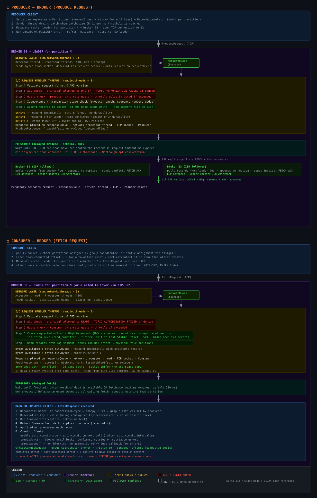

# Kafka Broker Overview
> **Updated for Apache Kafka 4.2 (KRaft mode only)**
> Source: kafka.apache.org/42 | Kafka: The Definitive Guide 2nd Edition
> 
> ⚠️ ZooKeeper has been completely removed in Kafka 4.0+. Only KRaft mode is supported.

---

## What Is a Kafka Broker?

A Kafka Broker is a server in a Kafka cluster that hosts topic partitions and processes client read/write requests. Brokers are responsible for storing published data according to configured retention policies. Together, brokers form a scalable, fault-tolerant distributed system.

In **Kafka 4.2 (KRaft mode)**, each server node can play one or more roles defined by `process.roles`:
- `broker` — handles client produce/consume requests and stores data
- `controller` — manages cluster metadata, leader election, and broker registration
- `broker,controller` — combined mode (development only, NOT recommended for production)

---

## Essential Broker Configurations (Kafka 4.2 / KRaft)

**Source:** kafka.apache.org/42/configuration/broker-configs/

The following configurations are **required** in KRaft mode:

| Configuration | Description |
|--------------|-------------|
| `node.id` | Unique integer ID for this broker/controller node. Replaces `broker.id`. |
| `process.roles` | Roles for this node: `broker`, `controller`, or `broker,controller`. |
| `log.dirs` | Directories where log data is stored. |
| `controller.quorum.bootstrap.servers` | List of controller nodes for the KRaft quorum. |
| `controller.listener.names` | Listener names used by the controller quorum. |

---

## Important Broker Properties

### `default.replication.factor`
- **Default**: 1 (recommended: ≥ 3 in production)
- **Description**: Default number of replicas for automatically created topics.
- **Trade-offs**: Higher replication increases fault tolerance but adds network and storage overhead.
- **Recommendation**: Always set ≥ 3 in production. Never exceed the number of brokers.

### `num.partitions`
- **Default**: 1
- **Description**: Default number of partitions per topic when auto-created.
- **Trade-offs**: More partitions = higher parallelism, but increases controller and client metadata overhead.
- **Note**: ⚠️ "Too many partitions can increase overhead on broker performance" — NOT ZooKeeper (removed in Kafka 4.x).

### `min.insync.replicas`
- **Default**: 1
- **Description**: Minimum number of in-sync replicas that must acknowledge a write when `acks=all`.
- **Trade-offs**: Higher value increases durability but may impact write latency.
- **Recommendation**: Set to 2 for production. Combine with `acks=all` and `replication.factor=3`.

### `unclean.leader.election.enable`
- **Default**: false
- **Description**: Allows an out-of-sync replica to become leader when no ISR members are available.
- **Trade-offs**: `true` increases availability but risks **data loss**. `false` prioritizes consistency.
- **Recommendation**: Keep `false` in production. Use only as emergency recovery measure.

### `num.replication.fetchers`
- **Default**: 1
- **Description**: Number of threads used by follower replicas to fetch data from the leader.
- **Trade-offs**: Increasing improves replication throughput at the cost of higher CPU usage.

### `replica.fetch.max.bytes`
- **Default**: 1048576 (1 MB)
- **Description**: Maximum bytes a replica fetches from the leader in a single request.
- **Trade-offs**: Larger values improve replication throughput but increase memory usage.

### `advertised.listeners`
- **Default**: Depends on setup
- **Description**: Hostname and port the broker advertises to producers, consumers, and other brokers. In KRaft mode, addresses are published to and managed by the controller.
- **Trade-offs**: Must be set correctly — clients use this to connect. Critical in cloud/NAT environments.

### `log.dirs`
- **Default**: `/tmp/kafka-logs`
- **Description**: Directories where partition log data is stored. Multiple directories spread I/O across disks.
- **Trade-offs**: Adequate disk space and I/O performance are critical. New partitions assigned round-robin across configured directories.

### `auto.create.topics.enable`
- **Default**: true
- **Description**: Allows automatic topic creation when a producer/consumer accesses a non-existent topic.
- **Trade-offs**: Convenient for development but may lead to unintentional topic creation in production.
- **Note**: Original summary used `auto.create.topic.enable` — correct property name is `auto.create.topics.enable`.

### `log.retention.hours` / `log.retention.bytes` / `log.segment.bytes`
- **Defaults**: 168 hours (7 days) / -1 (unlimited) / 1073741824 (1 GB)
- **Description**: Control retention policy by time, size, and segment size respectively.
- **Priority**: `log.retention.ms` > `log.retention.minutes` > `log.retention.hours`
- **Trade-offs**: Balance between disk usage and data availability.

### `log.retention.check.interval.ms`
- **Default**: 300000 (5 minutes)
- **Description**: Frequency at which the log cleaner checks for segments eligible for deletion.
- **Trade-offs**: More frequent checks improve timeliness of cleanup at a slight CPU cost.

### `broker.session.timeout.ms`
- **Default**: 18000 ms (18 seconds) — increased from 6s in Kafka 2.5+
- **Description**: In KRaft mode, the time before the controller considers a broker offline if no heartbeat is received.
- **Trade-offs**: Higher value reduces false positives (GC pauses, network blips) but increases detection latency.

### `log.flush.interval.messages` / `log.flush.interval.ms`
- **Defaults**: Long.MAX_VALUE / null
- **Description**: Control frequency of fsync to disk by message count or time interval.
- **Trade-offs**: Lower values increase durability but **severely impact performance**.
- **Recommendation**: ⚠️ Do NOT configure these. Rely on **replication** (`acks=all`, `min.insync.replicas=2`) for durability. Let the OS manage page cache flushing.

---

## Partition Management

- **Basics**: A Kafka topic is divided into one or more partitions distributed across brokers.
- **Replication Factor**: Each partition has N replicas. One is the leader, the rest are followers.
- **Immutability and Ordering**: Data written to a partition is immutable. Kafka guarantees **order within a partition** but NOT across partitions.
- **Partition count**: Can only be **increased**, never decreased.
- **Preferred Replica**: The first replica in the replica list is the "preferred leader". Kafka attempts to restore leadership to preferred replicas (`auto.leader.rebalance.enable=true`).

---

## Segment Management

- **Partition Segments**: Partitions are subdivided into segment files (log files) stored on disk.
- **Segment Size and Roll**: Controlled by `log.segment.bytes` (default: 1 GB) and `log.roll.ms`/`log.roll.hours`.
- **Active Segment**: The segment currently being written to. It is **never deleted** — even if retention policy applies.
- **Indexes**: Each segment has an offset index and a timestamp index for efficient message lookup.

```
Implication for retention:
  log.retention.ms = 7 days
  Topic receives 100 MB/day → segment fills in ~10 days
  Actual retention ≈ 17 days (10 days to fill + 7 days retention)
  because retention only applies to CLOSED segments!
```

---

## Log Retention and Cleanup

### Retention Policies

| Policy | Description |
|--------|-------------|
| `delete` (default) | Removes old segments when time or size limit is reached. |
| `compact` | Retains only the latest value per key. Uses tombstone records (null value) to delete keys. |
| `compact,delete` | Combines both: compacts retained segments AND deletes segments past retention limit. |

### Retention Configuration Hierarchy (time-based)
```
log.retention.ms       → highest priority (null by default)
    ↓ if null
log.retention.minutes  → secondary (null by default)
    ↓ if null
log.retention.hours    → tertiary (default: 168 = 7 days)
```

---

## Topic Replication

- **Leader and ISR**: One replica is the leader (handles all reads/writes). Others are In-Sync Replicas (ISR).
- **Eligible Leader Replicas (ELR)**: New in Kafka 4.0+ — replicas not in ISR but safe to elect as leader without data loss. Tracked by the KRaft controller.
- **Out-of-sync**: A replica is removed from ISR if it doesn't fetch from the leader within `replica.lag.time.max.ms` (default: 30 seconds).
- **Replication factor** should not exceed the number of brokers.

### Epochs (fencing stale state)

Kafka uses several monotonically increasing numbers called *epochs* to reject requests from "zombies" — nodes that still act on outdated state.

| Epoch | Scope | Incremented when | Used for |
|---|---|---|---|
| **Broker epoch** | One broker registration | A broker (re)registers with the controller (start, restart, session expiry) | Controller ignores requests from an **old incarnation** of a broker |
| **Leader epoch** | One partition | A new partition leader is elected | Fences stale leaders. Follower log truncation after failover |
| **Controller / quorum epoch** | Whole cluster | A new active KRaft controller is elected | Fences a stale (deposed) controller |

**Broker epoch — what it is for**

- Assigned by the **controller** each time a broker registers. In KRaft it is the **metadata log offset** of that broker's `RegisterBrokerRecord` (in old ZooKeeper clusters it was the zxid of the broker's ephemeral znode), so a restarted broker always gets a **higher** epoch.
- The broker sends its epoch in controller-bound requests (heartbeat, `AlterPartition`, ...) and the controller includes the target broker's epoch in requests it sends (`LeaderAndIsr`, `UpdateMetadata`, `StopReplica`).
- If the epoch in a request is **lower than the current one**, it is rejected with `STALE_BROKER_EPOCH`. This prevents a broker that was restarted, partitioned or paused (long GC) from applying or sending outdated leadership / ISR changes after the cluster has moved on.
- It is internal bookkeeping: it is not a configuration and clients never see it.

**Leader epoch — related, more exam-relevant**

- Stored in every record batch and in each log's `leader-epoch-checkpoint` file (`epoch → first offset of that epoch`).
- When a follower restarts or a leader changes, the follower asks the new leader for the end offset of its last known epoch (`OffsetForLeaderEpoch`) and **truncates diverging records** — this is more reliable than using the high watermark alone, which could cause log divergence or data loss.
- Requests carrying an older leader epoch get `FENCED_LEADER_EPOCH`. Consumers also use it to detect stale metadata.

> 💡 **Remember:** epochs only go up. A higher epoch always wins. Requests with a lower epoch are fenced (rejected).

---

## Producer Considerations

- **`acks`**: Controls durability guarantee.
    - `acks=0` — No acknowledgment (fastest, highest risk of loss)
    - `acks=1` — Leader acknowledges (default before 3.0, risk of loss on leader crash)
    - `acks=all` — All ISR replicas acknowledge (safest, use with `min.insync.replicas=2`)
- **`message.max.bytes`**: Maximum message size (default: 1 MB). Must be coordinated with `fetch.max.bytes` on consumers and `replica.fetch.max.bytes` on brokers.
- **Message Keys**: Same key always routes to the same partition (with default or custom partitioner), enabling ordering by key **as long as partition count does not change**.
- **Idempotent Producer**: `enable.idempotence=true` prevents duplicate messages caused by retries (requires `acks=all`, `max.in.flight.requests.per.connection ≤ 5`).
- **Compression**: Set on producer (`compression.type=snappy/lz4/zstd/gzip`). Broker stores AS-IS (zero-copy). Consumer decompresses **automatically** — no consumer-side configuration needed.

---

## Consumer Considerations

- **Offsets**: Consumers track progress via offsets committed to `__consumer_offsets` topic.
- **Consumer Groups**: Created **automatically** when a consumer first joins (no CLI command to create them).
- **`auto.offset.reset`**: Controls behavior when no committed offset exists:
    - `earliest` — start from oldest available offset
    - `latest` — start from newest offset (default)
    - `none` — throw `NoOffsetForPartitionException`
- **Partition Assignment**: Kafka automatically assigns partitions to consumers in a group. One partition → one consumer (never shared within a group). Max active consumers = number of partitions.

---

## Broker Performance Tuning

### Thread Configuration
| Parameter | Default | Description |
|-----------|---------|-------------|
| `num.network.threads` | 3 | Threads for network I/O (reading requests, sending responses). |
| `num.io.threads` | 8 | Threads for processing requests (disk reads/writes). Should equal CPU count. |
| `num.replication.fetchers` | 1 | Threads for replica fetching. |

### Key Performance Metrics
- **`RequestHandlerAvgIdlePercent`**: < 20% = potential problem, < 10% = active problem.
- **`NetworkProcessorAvgIdlePercent`**: Indicates network thread saturation.

### Log Flush — Important Warning
```
❌ DO NOT set log.flush.interval.messages or log.flush.interval.ms
   manually in production!

✅ Instead, rely on:
   - acks=all
   - min.insync.replicas=2
   - replication.factor=3
   - OS page cache (Linux manages this efficiently)
```

---

## Zero Copy

Kafka achieves high-throughput message delivery using the **Zero Copy** principle:
- Data is transferred directly from the filesystem (page cache) to the socket buffer.
- Eliminates intermediate CPU copies — significantly reduces CPU usage and latency.

**⚠️ Zero Copy is disabled when SSL is enabled:**
- With SSL, the broker must decrypt incoming data and re-encrypt outgoing data.
- This reintroduces intermediate data copies and increases CPU usage (up to 20-30% overhead).
- Implication: SSL listeners have higher CPU requirements than PLAINTEXT listeners.

---

## Security Configurations

- **Encryption**: SSL/TLS (`SASL_SSL` or `SSL` security protocol) encrypts data in transit.
- **Authentication**: SASL supports `GSSAPI` (Kerberos), `PLAIN`, `SCRAM-SHA-256/512`, `OAUTHBEARER`.
- **Authorization**: ACLs managed by `StandardAuthorizer` (the KRaft authorizer. `AclAuthorizer` was the ZooKeeper-era class) — fine-grained control over read/write/create/delete operations.
- **Listeners**: Multiple listeners can be configured for different security protocols (internal PLAINTEXT, external SASL_SSL).

```properties
# Example multi-listener setup
listeners=INTERNAL://0.0.0.0:9092,EXTERNAL://0.0.0.0:9093
listener.security.protocol.map=INTERNAL:PLAINTEXT,EXTERNAL:SASL_SSL
inter.broker.listener.name=INTERNAL
advertised.listeners=INTERNAL://broker1.internal:9092,EXTERNAL://broker1.example.com:9093
```
```
# ─────────────────────────────────────────────────────────────
# WHERE the broker BINDS (what it listens on locally)
# Format: NAME://host:port  (0.0.0.0 = all network interfaces)
# ─────────────────────────────────────────────────────────────
listeners=INTERNAL://0.0.0.0:9092,EXTERNAL://0.0.0.0:9093
#          │                │       │                │
#          │                │       │                └─ binds port 9093 on all NICs
#          │                │       └─ second listener named EXTERNAL
#          │                └─ binds port 9092 on all NICs
#          └─ first listener named INTERNAL
#
# The broker opens TWO server sockets.
# Names (INTERNAL, EXTERNAL) are arbitrary — they're just labels.

# ─────────────────────────────────────────────────────────────
# WHAT SECURITY PROTOCOL each listener uses
# ─────────────────────────────────────────────────────────────
listener.security.protocol.map=INTERNAL:PLAINTEXT,EXTERNAL:SASL_SSL
#                               │         │         │        │
#                               │         │         │        └─ EXTERNAL uses TLS + SASL auth
#                               │         │         └─ second mapping
#                               │         └─ INTERNAL uses plain TCP, no auth
#                               └─ first mapping
#
# PLAINTEXT  = no encryption, no auth  (safe only on private/trusted networks)
# SASL_SSL   = TLS encryption + SASL authentication (PLAIN, SCRAM, GSSAPI etc.)
# Other options: SSL (TLS only, no SASL), SASL_PLAINTEXT (SASL but no TLS)

# ─────────────────────────────────────────────────────────────
# WHICH listener brokers use to talk TO EACH OTHER
# ─────────────────────────────────────────────────────────────
inter.broker.listener.name=INTERNAL
#
# Broker-to-broker replication (follower fetches from leader) uses
# the INTERNAL listener → plain TCP on port 9092.
# This avoids the overhead of TLS + SASL for trusted internal traffic.
# Must be one of the names defined in listeners above.

# ─────────────────────────────────────────────────────────────
# WHAT ADDRESS the broker ADVERTISES to clients (via metadata)
# This is what clients actually connect to — NOT 0.0.0.0
# ─────────────────────────────────────────────────────────────
advertised.listeners=INTERNAL://broker1.internal:9092,EXTERNAL://broker1.example.com:9093
#                    │          │                  │    │          │                   │
#                    │          │                  │    │          │                   └─ public DNS, port 9093
#                    │          │                  │    │          └─ resolvable from internet/external clients
#                    │          │                  │    └─ external clients use this address
#                    │          │                  └─ internal DNS, port 9092
#                    │          └─ resolvable only within the internal network
#                    └─ internal clients / other brokers use this address
#
# When a client connects to ANY broker and asks for metadata,
# the broker returns advertised.listeners — the client then
# connects DIRECTLY to those addresses for produce/fetch.
# 0.0.0.0 must NEVER appear here — clients can't connect to 0.0.0.0.
```


---

## Monitoring and Management

### Key JMX Metrics

| Broker Metric | Description |
|---------------|-------------|
| `ActiveControllerCount` | Must be exactly 1 across the cluster. 0 = no controller (critical!), 2 = split-brain (critical!). |
| `RequestHandlerAvgIdlePercent` | % of time request handler threads are idle. <20% = warning, <10% = critical. |
| `UnderReplicatedPartitions` | Partitions where followers are behind the leader. Should be 0 in healthy clusters. |
| `OfflinePartitionsCount` | Partitions without an active leader. Should always be 0. |
| `BytesInPerSec` | Incoming byte rate — used for capacity planning. |
| `BytesOutPerSec` | Outgoing byte rate — includes replication traffic. |
| `MessagesInPerSec` | Incoming message rate. |
| `PartitionCount` | Number of partitions assigned to broker. Should be evenly distributed. |
| `LeaderCount` | Number of partitions where broker is leader. Should be ~equal across brokers. |
| `ControllerEventQueueSize` | Size of controller event queue. Sustained high value = controller stuck. |
| `RequestsPerSec` | Request rate per type (Produce, Fetch, Metadata, etc.). |

### Log and Disk Monitoring
- Monitor `UnderReplicatedPartitions` — fluctuating values indicate performance issues. Stable non-zero = broker offline.
- Monitor disk usage — Kafka does NOT stop writing when disk is full — it crashes!
- Monitor `log.dirs` for I/O wait time.

---

## High Availability Considerations (KRaft)

**Source:** kafka.apache.org/42/operations/kraft/

- **KRaft Controller Quorum**: Replaces ZooKeeper entirely. Requires 3 or 5 controller nodes for fault tolerance.
    - 3 controllers → tolerates 1 controller failure
    - 5 controllers → tolerates 2 controller failures
- **Metadata Storage**: Cluster metadata persisted in `__cluster_metadata` topic on controller nodes' local disk (`metadata.log.dir`).
- **Broker Metadata Cache**: Brokers maintain an **in-memory** metadata cache refreshed from the controller via `MetadataFetch API`. NOT persisted on broker disk.
- **Broker Session**: Brokers maintain active session with controller via heartbeats (`broker.session.timeout.ms=18s`).

```
❌ REMOVED from Kafka 4.x:
   - ZooKeeper dependency
   - --zookeeper flag in CLI tools
   - zookeeper.connect broker configuration

✅ REPLACED by KRaft:
   - controller.quorum.bootstrap.servers
   - process.roles
   - node.id
   - metadata.log.dir
```

---

## Points to Remember for CCDAK

```
1. Kafka 4.2 = KRaft ONLY — ZooKeeper completely removed!

2. Essential KRaft configs:
   node.id, process.roles, log.dirs,
   controller.quorum.bootstrap.servers

3. Durability formula for production:
   replication.factor=3
   min.insync.replicas=2
   acks=all (producer)

4. unclean.leader.election.enable=false (default)
   → Consistency over availability
   → Data loss risk if set to true!

5. Zero Copy disabled with SSL
   → Higher CPU overhead with encrypted listeners

6. Partition count:
   → Can only INCREASE, never decrease
   → Increasing changes key→partition mapping!

7. Active segment is NEVER deleted
   → Actual retention > configured retention.ms
     when topic has low throughput

8. Consumer groups created AUTOMATICALLY
   → No CLI command to create them

9. Compression:
   → Set on PRODUCER only
   → Consumer decompresses AUTOMATICALLY
   → No consumer-side compression config needed

10. log.flush settings:
    → Do NOT configure in production
    → Rely on replication for durability
```

## Resource Hierarchy (CCDAK)

```
Cluster
 ├── Broker (node; in KRaft: broker and/or controller role)
 │    └── hosts partition replicas
 ├── Topic  (logical name, config overrides, ACL resource)
 │    └── Partition  (ordered, immutable log; unit of parallelism)
 │         ├── Replicas (1 leader + followers; ISR = in-sync subset)
 │         └── Segments (files on disk: .log, .index, .timeindex; one active segment)
 │              └── Records (offset, timestamp, key, value, headers)
 └── Consumer Group (tracked by group coordinator. Committed offsets stored in __consumer_offsets)
```

- **Topic** = logical **partition** = physical unit of ordering, parallelism and replication **segment** = unit of retention/deletion (only closed segments are deleted/compacted).
- A partition lives on one broker as leader. Each replica is a full copy on a different broker.
- ACL resource types: Cluster, Topic, Group, TransactionalId, DelegationToken.
- Offsets are unique **per partition**, not per topic.

## Request Lifecycle in Kafka (CCDAK)

1. Client finds the partition leader via a **Metadata request** (any broker answers) and caches the metadata. A `NOT_LEADER_OR_FOLLOWER` error triggers a metadata refresh.
2. Client sends a Produce/Fetch request **to the partition leader** over TCP.
3. A broker **network (acceptor/processor) thread** reads the request and puts it on the **request queue**.
4. An **I/O (request handler) thread** takes it from the queue, validates it, and:
   - **Produce**: appends to the leader's log (page cache). With `acks=all` the request waits in **purgatory** until all ISR replicas have replicated it (`min.insync.replicas` enforced) or it times out.
   - **Fetch**: reads from the log (zero-copy `sendfile`). If less than `fetch.min.bytes` is available the request waits in purgatory up to `fetch.max.wait.ms`.
5. The response is placed on the **response queue** and the network thread sends it to the client.

- Consumers (default) fetch only from the leader. Followers fetch from the leader like consumers. With `client.rack` + `replica.selector.class` consumers can fetch from the closest follower (KIP-392).
- Consumers only see records up to the **high watermark** (replicated to all ISR). With `read_committed` only up to the Last Stable Offset.
- Thread pools: `num.network.threads` (network), `num.io.threads` (request handlers).

