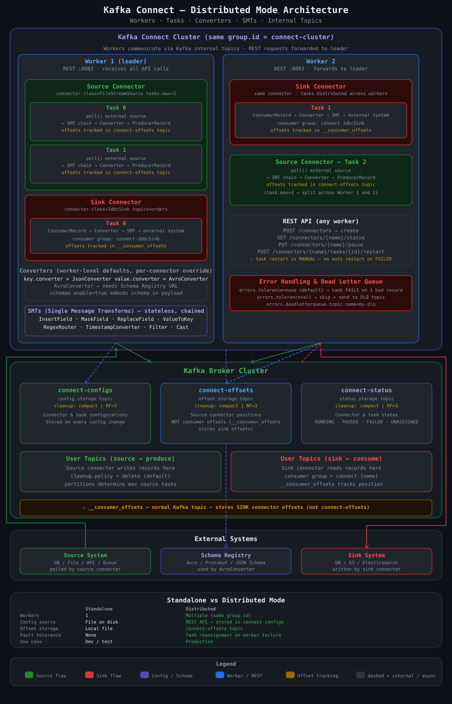

> 🚫 = outside the CCDAK exam scope (see exam blueprint)

## Kafka Connect Overview

Kafka Connect is a tool specifically designed for streaming data between Apache Kafka and other systems.

- A common framework for Kafka connectors.
- Distributed and standalone modes.
- REST interface.
- Automatic offset management.
- Distributed and scalable by default.
- Streaming/batch integration.

### Key Concepts

- **Connectors**: The components in Kafka Connect that implement the connection to other systems. There are two types of connectors: Source connectors for importing data into Kafka, and Sink connectors for exporting data from Kafka.
- **Tasks**: The actual workers that perform the data import or export. Each connector could be split into multiple tasks that can be distributed over a cluster for scalability and fault tolerance.
- **Converters**: Responsible for converting data between Kafka Connect's internal data format and the format required by external systems.

### Core Components

- **Worker**: The runtime environment where connectors and tasks are executed. Workers can be standalone (single process) or distributed across multiple nodes.
- **REST API**: Kafka Connect provides a REST API for managing connectors and tasks, making it easy to deploy and monitor without writing any code.

### Key Connector configurations

Connector configurations are simple key-value mappings. In standalone mode, these are defined in a properties file and passed to the Connect process on the command line. In distributed mode, they are included in the JSON payload for the request that creates or modifies the connector.

Most configurations are connector-dependent, so they can't be outlined here. However, there are a few common options:

- **name:** Unique name for the connector. Attempting to register again with the same name will fail.
- **connector.class:** The Java class for the connector.
- **tasks.max:** The maximum number of tasks that should be created for this connector. The connector may create fewer tasks if it cannot achieve this level of parallelism.
- **key.converter:** (Optional) Override the default key converter set by the worker.
- **value.converter:** (Optional) Override the default value converter set by the worker.

### Important Operations

- **Configuring Connectors**: Understand how to configure source and sink connectors, including specifying the name of the Kafka topics to use, the key and value converters, and any connector-specific settings.
    ```json
    {
      "name": "example-connector",
      "config": {
        "connector.class": "org.example.MyConnector",
        "tasks.max": "1",
        "topics": "my-topic",
        "key.converter": "org.apache.kafka.connect.storage.StringConverter",
        "value.converter": "org.apache.kafka.connect.json.JsonConverter",
        "value.converter.schemas.enable": "false",
        ...
      }
    }
    ```
- **Deploying and Scaling**: Knowledge on deploying connectors in a distributed mode to leverage Kafka Connect's scalability and fault tolerance.
- **Monitoring and Managing Connectors**: Using the REST API to monitor the health and performance of connectors and tasks, and to dynamically adjust their configuration.

### Best Practices

- **Error Handling and Retry Policies**: Implement robust error handling and retry mechanisms to ensure resilience and reliability.
- **Offset Management**: Proper management of offsets to ensure accurate and reliable data processing.
- **Securing Kafka Connect**: Apply security configurations, including encryption and authentication, to protect data in transit and at rest.

### REST API Operations

Kafka Connect's REST API provides comprehensive control over connectors and tasks, allowing for dynamic management without direct code intervention.

- **Worker Information**: Retrieve details about Kafka Connect workers.
- **Connectors Management**: List, create, update, pause, resume, and delete connectors.
- **Tasks Management**: Monitor and manage the individual tasks of each connector.
- **Configuration Management**: View and update connector configurations.

### Internal Topics of Kafka Connect

In **distributed mode**, Kafka Connect maintains its state, configuration, and progress in **three** internal Kafka topics. Their names are not fixed by Kafka — you set them with the worker configs below — but there is a widely used convention (also the default in Confluent's sample `connect-distributed.properties`):

| Worker config | Stores | Conventional name | Recommended settings |
|---|---|---|---|
| `config.storage.topic` | Connector **and** task configurations | `connect-configs` | 1 partition, `cleanup.policy=compact`, RF ≥ 3 |
| `offset.storage.topic` | Source-connector offsets **only** (progress tracking) | `connect-offsets` | ~25 partitions, `cleanup.policy=compact`, RF ≥ 3 |
| `status.storage.topic` | Connector and task state/status (`RUNNING`, `FAILED`, `PAUSED`, etc.) **and assigned worker node ID** | `connect-status` | ~5 partitions, `cleanup.policy=compact`, RF ≥ 3 |

Notes:

- There is **no separate task-config topic**: connector config *and* task config both live in the single `config.storage.topic`.
- All three topics are **log-compacted** so only the latest value per key is retained.
- Set replication factors with `config.storage.replication.factor`, `offset.storage.replication.factor`, and `status.storage.replication.factor` (use ≥ 3 in production).
- Workers auto-create these topics on startup if they do not exist, but it is recommended to **create them manually** so you control the partition count, replication factor, and compaction policy before the workers start.
- These are internal topics managed by Kafka Connect and should **not** be modified or consumed by external applications.
- The Confluent Platform Docker images default these names to `connect-configs`, `connect-offsets`, `connect-status` (sometimes prefixed, e.g. `docker-connect-...`).
- Kafka Connect does **not** use ZooKeeper at all (it coordinates via Kafka's group protocol and internal topics. ZooKeeper is removed entirely in Kafka 4.x). In distributed mode, connector configs are never stored in local worker files or in the broker's config directory.

In **standalone mode** there are no such Kafka topics — offsets are kept in a **local file** given by `offset.storage.file.filename` (e.g. `/tmp/connect.offsets`), and configuration comes directly from the `.properties` files.

> Separately, **sink** connectors consume via a normal consumer group (`connect-<connector-name>`), so their consumer offsets live in Kafka's `__consumer_offsets` topic — that is a general Kafka internal topic, not a Connect-specific one.

> ⚠️ **Exam traps (Internal Topics):**
> - `connect-offsets` stores **source** connector offsets only — **never** sink connector offsets.
> - `connect-status` stores connector/task state **and** the worker node ID each task is assigned to — it does **not** store configurations (`connect-configs`) or offsets (`connect-offsets` / `__consumer_offsets`).
> - Connector configs in distributed mode are stored in `connect-configs`, **not** in ZooKeeper, worker files, or broker config directories.

These internal topics enable Kafka Connect to recover from failures, ensuring robust and reliable data streaming.

### Configuration Options

#### Common Worker Configurations

- **`bootstrap.servers`**: The Kafka cluster to connect to.
- **`key.converter`** and **`value.converter`**: Converters for record keys and values.
- **`offset.flush.interval.ms`**: Frequency at which to save offsets.
- **`plugin.path`**: Path to directory containing Kafka Connect plugins.

#### Additional Configurations
- **Standalone mode**:
 - `offset.storage.file.filename`: File to store offset data
- **Distributed mode**:  
 - `group.id`: Unique name for the cluster
 - `config.storage.topic`: Topic for storing connector and task configurations
 - `offset.storage.topic`: Topic for storing offsets
 - `status.storage.topic`: Topic for storing statuses

#### Distributed Worker Configurations

- **`group.id`**: Unique identifier for the Kafka Connect cluster.
- **`config.storage.topic`** and **`offset.storage.topic`**: Kafka topics for storing connector and task configurations and offsets.

In distributed mode for Kafka Connect, key features include automatic work balancing, dynamic scaling, and fault tolerance. While configuration parameters are similar to standalone mode, the storage locations and classes differ. In distributed mode, Kafka Connect stores offsets, configurations, and task statuses in Kafka topics. It is recommended to manually create these topics to achieve the desired number of partitions and replication factors.
```properties
# Worker identity
bootstrap.servers=broker1:9092,broker2:9092
group.id=connect-cluster                    # all workers with same group.id form one cluster

# Internal topics
config.storage.topic=connect-configs
offset.storage.topic=connect-offsets
status.storage.topic=connect-status
config.storage.replication.factor=3
offset.storage.replication.factor=3
status.storage.replication.factor=3

# Converters (worker-level defaults)
key.converter=org.apache.kafka.connect.json.JsonConverter
value.converter=org.apache.kafka.connect.json.JsonConverter
key.converter.schemas.enable=false
value.converter.schemas.enable=false

# REST API
rest.port=8083
rest.advertised.host.name=worker1.internal
rest.advertised.port=8083
```

Execution is similar to standalone mode:

```
bin/connect-distributed.sh config/connect-distributed.properties
```

#### 🚫 JDBC Sink Configuration Options

- **`connection.url`**, **`connection.user`**, **`connection.password`**: Database connection details.
- **`insert.mode`**: Mode of inserting data into the database.
- **`auto.create`** and **`auto.evolve`**: Automatically create and modify database schemas.

### Connector Types

- **Source Connectors**: Import data from external systems (databases, IoT/MQTT, HTTP APIs, mainframes, files, etc.) into Kafka topics.
- **Sink Connectors**: Export data from Kafka topics to external systems (relational databases, Elasticsearch, S3, HDFS, NoSQL, files, etc.).

> ⚠️ **Exam trap:** Only **Source** and **Sink** connector types exist in Kafka Connect. "Transformation Connector", "Import Connector", and "Export Connector" are not real connector types — transformations are applied via SMTs in a connector's configuration.

### Choosing the Right Component & Architecture Patterns

| Use Case | Recommended Tool |
|---|---|
| External system → Kafka (with optional lightweight per-record SMTs) | **Kafka Connect Source Connector** |
| Kafka → Kafka (real-time aggregations, running totals, joins, anonymization, anomaly detection) | **Kafka Streams** (or 🚫 **ksqlDB** for SQL-proficient teams) |
| Kafka → External system (DB, search index, S3, HDFS) | **Kafka Connect Sink Connector** |
| End-to-end real-time pipeline (External → process → External) | **Source Connector → Kafka → Kafka Streams → Kafka → Sink Connector** |

Common architecture patterns and anti-patterns:

- **Heterogeneous multi-source ingestion**: Use a mix of Kafka Connect Source Connectors suited to each source technology (SQL DBs, cloud storage, IoT/MQTT, mainframes) rather than building custom embedded producers.
- **Data privacy & filtering**: Use Source Connectors (with SMTs to filter proprietary/unwanted fields at ingestion) combined with Kafka Streams to anonymize sensitive fields before downstream analytics or fraud detection.
- **Real-time enrichment from external APIs**: Ingest each data source into its own Kafka topic using appropriate Source Connectors (e.g., MQTT Source for sensor telemetry + HTTP Source for weather forecasts), then join/enrich them in **Kafka Streams**.
  - **Avoid** making per-record REST API calls directly inside Kafka Streams (introduces high latency, rate-limit issues, and tight coupling).
  - **Avoid** writing data to an intermediate database + cron job + re-ingesting into Kafka (unnecessary complexity and latency).
  - **Avoid** batch ETL / nightly DB dumps / periodic CSV exports when real-time or low-latency processing is required.
- **Scaling processing vs. ingestion**: When data is **already in Kafka** and processing is the bottleneck under fluctuating load, scale **Kafka Streams application instances** up or down (up to the number of partitions/tasks).
  - Do **not** scale Source Connector tasks to fix a downstream processing bottleneck.
  - Do **not** dynamically change topic partition counts for fluctuating loads (partitions can only be increased, never decreased, and changing them breaks key-to-partition mapping and triggers rebalances).
  - Do **not** change replication factor for throughput (replication factor affects durability/availability, not processing capacity).

### 🚫 Source Connectors (system-specific connectors)
These connectors ingest data from external systems into Kafka topics.
- **JDBC Source Connector**: Ingests data from relational databases into Kafka.
- **File Source Connector**: Reads files from a file system and ingests their contents into Kafka topics.
- **MQTT Source Connector**: Integrates IoT device data communicated over MQTT protocol into Kafka.
- **Twitter Source Connector**: Streams live tweets directly into Kafka topics (legacy community connector).


### Single Message Transforms (SMT)
- **SMTs** are Kafka Connect transformations that are applied to data as it passes through a connector, allowing for modification of the data (such as enrichment, filtering, or transformation) before it lands in the destination.

### Change Data Capture (CDC)
- **CDC** captures row-level changes (inserts, updates, deletes) from a database, typically by reading its transaction log (e.g. Debezium), and streams only incremental changes into Kafka.
- Compared with query-based ingestion (e.g. JDBC source polling) or batch ETL:
  - **Lower latency** (captures changes as they happen — ideal for real-time fraud detection, inventory, and live user interactions).
  - **Minimizes network bandwidth** by streaming only new or modified records (critical in bandwidth-limited environments such as distributed retail POS stores).
  - **Lower load on the source database** and **captures deletes**.

### Data Enrichment
- **Data enrichment** in the context of Kafka involves augmenting messages in a stream with additional information. This can be achieved by joining streams with other data sources (e.g., tables or databases) to add context or additional details to the original data.

### Error Handling

Kafka Connect provides error reporting to handle errors encountered at various stages of processing. By default, any error during conversion or transformations causes the connector to fail. Each connector configuration can also enable tolerating such errors by skipping them and optionally writing each error and details of the failed operation and problematic record to the Connect application log.

To report errors within a connector's converter, transforms, or within the sink connector itself to the log, set `errors.log.enable=true` in the connector configuration to log details of each error and the problem record's topic, partition, and offset. For additional debugging purposes, set `errors.log.include.messages=true` to also log the problem record key, value, and headers (note this may log sensitive information).

To report errors within a connector's converter, transforms, or within the sink connector itself to a dead letter queue topic, set `errors.deadletterqueue.topic.name`, and optionally `errors.deadletterqueue.context.headers.enable=true`.

## REST API
- Kafka Connect provides a REST API for managing connectors
- Key endpoints include viewing connector configurations, status, and restarting connectors and tasks
- Secured clusters require additional configurations for the REST API
```properties
# List connectors
GET  /connectors

# Create connector
POST /connectors
     {"name": "my-connector", "config": {...}}

# Get connector status
GET  /connectors/{name}/status

# Pause / Resume
PUT  /connectors/{name}/pause
PUT  /connectors/{name}/resume

# Restart connector
POST /connectors/{name}/restart

# Restart individual task
POST /connectors/{name}/tasks/{taskId}/restart

# Delete connector
DELETE /connectors/{name}

# List plugins
GET  /connector-plugins

# Validate config
PUT  /connector-plugins/{className}/config/validate
```

## 🚫 Connector Development
- Connectors are responsible for breaking down a data copying job into tasks and monitoring for changes
- `SourceConnector`s import data from systems into Kafka, `SinkConnector`s export data from Kafka to systems
- Developers must implement the `Connector` and `Task` interfaces
- Tasks should have consistent data schemas for the input/output streams and records

## 🚫 Configuration Validation
- Kafka Connect allows configuration validation using `ConfigDef` and the `validate()` method
- Provides feedback about errors and recommended values before running connectors

## 🚫 Schemas and the Kafka Connect Data API
- More complex data requires using the data API to define schemas using `Schema` and `Struct` classes
- Source connectors may have static or dynamic schemas and should avoid recomputing them frequently
- Sink connectors should validate that consumed data has the expected schema

## Kafka Connect In-Depth

### 1. Connect Architecture
- Kafka Connect runs as a separate process from the Kafka brokers.
- It can run in standalone mode (single process) or distributed mode (multiple instances).
- In distributed mode, Connect distributes the work of connectors across multiple worker instances.
- Workers form a group via Kafka's group protocol and use Kafka topics (`config.storage.topic`, `offset.storage.topic`, `status.storage.topic`) for configuration, source offset storage, and status updates. Connect does not use ZooKeeper.
- Connectors are responsible for breaking down data copying tasks and generating task configurations.
- Tasks are the actual units of work that perform data copying.
- The `tasks.max` parameter determines the maximum number of tasks a connector can create.

To understand Kafka Connect's internals, let's define its key concepts:

- **Connectors**: Manage tasks to coordinate data streaming.
- **Tasks**: Define how data is moved between Kafka and external systems.
- **Workers**: Running processes that execute connectors and tasks.
- **Converters**: Translate data between Connect and external systems.
- **Transforms**: Modify messages produced by or sent to a connector.
- **Dead Letter Queue**: Handle connector errors.

Connectors in Kafka Connect are responsible for breaking down the data copying job into tasks that can be distributed to workers.

### 🚫 2. Connector Development
- Connectors are implemented as Java classes that extend either `SourceConnector` or `SinkConnector`.
- The `taskClass()` method returns the class of the `Task` implementation (`SourceTask` or `SinkTask`).
- The `start()` method is called when the connector is started and initializes any necessary resources.
- The `stop()` method is called when the connector is stopped and cleans up any resources.
- The `config()` method returns the configuration definition for the connector.
- The `taskConfigs()` method generates task configurations based on the connector's configuration and the maximum number of tasks.
- `SourceTask` implementations define the `poll()` method to fetch data from the external system and return a list of source records.
- `SinkTask` implementations define the `put()` method to receive a list of sink records and write them to the external system.

### 3. Converters and Serialization
- Converters are used to translate between the Connect data format and the serialized form stored in Kafka.
- The `key.converter` and `value.converter` properties specify the converter classes for record keys and values, respectively.
- Common converters include `JsonConverter`, `AvroConverter`, and `StringConverter`.
- Converters can be configured with additional properties, such as `schemas.enable` to include schema information in the serialized data.

### 4. Single Message Transforms (SMTs)
- SMTs perform lightweight modifications to records as they flow through a connector.
- They operate on individual records and should not perform complex operations like joins or aggregations.
- SMTs are configured as part of the connector configuration using the `transforms` property.
- The `transforms` property specifies a comma-separated list of transform aliases.
- Each transform alias is configured with additional properties, such as `transforms.<alias>.type` to specify the transform class.
- Common SMTs include `MaskField`, `ReplaceField`, `ExtractField`, and `InsertField`.
```properties
transforms=addTimestamp,maskField
transforms.addTimestamp.type=org.apache.kafka.connect.transforms.InsertField$Value
transforms.addTimestamp.timestamp.field=ingest_time
transforms.maskField.type=org.apache.kafka.connect.transforms.MaskField$Value
transforms.maskField.fields=credit_card,ssn
```

**Key built-in SMTs:**

| SMT | Purpose |
|---|---|
| `InsertField` | Add field with static value or timestamp |
| `ReplaceField` | Rename, include, or exclude fields |
| `MaskField` | Replace field value with null/zero/empty |
| `ExtractField` | Pull one field out as the entire value |
| `ValueToKey` | Copy field(s) from value into the record key |
| `TimestampConverter` | Convert timestamp format/type |
| `Filter` | Drop records matching a condition |
| `Flatten` | Flatten nested structs |
| `HoistField` | Wrap entire value in a named field |
| `Cast` | Type cast fields |
| `RegexRouter` | Reroute to different topic via regex |
| `TimestampRouter` | Route to topic based on timestamp |

- `$Key` vs `$Value` suffix: applies transform to key or value
- SMT applied **after** converter on source, **before** converter on sink

> ⚠️ **Exam trap:** SMTs are **stateless** — no aggregation, no joins, no lookups from external systems
>
> ⚠️ **Exam trap:** For complex logic use Kafka Streams, not SMTs

### 5. Error Handling and Dead Letter Queues
- Connectors can define error handling behavior using the `errors.tolerance` property.
- The `errors.tolerance` property can be set to `none` (default, fail on any error) or `all` (skip problematic records and continue).
- Dead letter queue (DLQ) can be configured to capture failed records using the `errors.deadletterqueue.topic.name` property.
- The `errors.deadletterqueue.context.headers.enable` property can be set to `true` to include error context in the DLQ record headers.
- Monitoring and handling records in the DLQ is important to identify and resolve issues with connector configuration or data compatibility.

### 6. Offset Management
- Connectors manage offsets to track the progress of data copying.
- Source connectors use offsets to determine where to resume reading from the external system in case of failures or restarts.
- Sink connectors use offsets to track the progress of writing records to the external system.
- Source connector offsets are stored in a Kafka topic specified by the `offset.storage.topic` property (distributed mode).
- The `offset.flush.interval.ms` property controls how frequently offsets are flushed to the offset storage topic.
- Sink connector offsets are stored as regular consumer group offsets (`__consumer_offsets`), not in the Connect offsets topic. In standalone mode, source offsets are stored in a file (`offset.storage.file.filename`).
- By default, Connect provides at-least-once delivery. Offset management enables fault tolerance and resuming after failures.

### 7. Exactly-Once Semantics (EOS)
- Kafka Connect delivers at-least-once by default.
- Exactly-once for **source connectors** is supported since Kafka 3.3 (KIP-618) and must be enabled and supported by the connector:
 - Worker config: `exactly.once.source.support=enabled` (or `preparing` during a rolling upgrade). Default is `disabled`.
 - Connector config: `exactly.once.support=requested|required` and optionally `transaction.boundary` (`poll`, `interval`, `connector`).
 - Source records and offsets are written to Kafka in a transaction by the worker's producer.
- For **sink connectors**, Connect cannot guarantee exactly-once by itself. It depends on the connector writing idempotently to (or transactionally with offsets in) the external system.
- EOS requires careful configuration and compatibility between the connector and the external system.

### 🚫 8. Schema Evolution
- Kafka Connect supports schema evolution for connectors that use schema-based serialization formats like Avro or Protobuf.
- Schema evolution allows the schema of records to change over time while maintaining compatibility with existing data.
- The Confluent Schema Registry is often used in conjunction with Kafka Connect to manage and evolve schemas.
- Connectors can be configured with the `value.converter.schema.registry.url` property to specify the URL of the Schema Registry.
- When consuming records with a schema, the connector retrieves the schema from the Schema Registry based on the schema ID stored with the record.
- Schema evolution strategies, such as backward and forward compatibility, need to be considered when making changes to record schemas.

### 9. Monitoring and Metrics
- Kafka Connect exposes metrics for monitoring the performance and health of connectors and tasks.
- Metrics are exposed through JMX (Java Management Extensions) and can be collected using monitoring tools like JMX exporters or Prometheus.
- Key metrics to monitor include:
 - `connector-destroyed-task-count`: The number of destroyed tasks for a connector.
 - `connector-failed-task-count`: The number of failed tasks for a connector.
 - `connector-paused-task-count`: The number of paused tasks for a connector.
 - `connector-running-task-count`: The number of running tasks for a connector.
 - `connector-unassigned-task-count`: The number of unassigned tasks for a connector.
 - `source-record-poll-total`: The total number of records polled by a source connector.
 - `sink-record-read-total`: The total number of records read by a sink connector.
 - `sink-record-send-total`: The total number of records sent by a sink connector.
- Monitoring metrics helps identify performance bottlenecks, connectivity issues, and resource utilization of Kafka Connect.



## Connector Scalability & Fault Tolerance (CCDAK)

### Core Scalability Model
- **Connector** = job definition (config). **Task** = unit of parallelism that actually copies data. **Worker** = JVM process that runs connectors/tasks.
- Scalability is controlled by **manually configuring `tasks.max`** per connector and running multiple workers in distributed mode (same `group.id`) so tasks are distributed across workers.
- Multiple connectors can run in the **same** Kafka Connect cluster — you do not need a separate cluster per connector.
- Size `tasks.max` according to available worker resources (CPU, memory) as well as the natural parallelism of the data source/sink.
- **Standalone mode**: single worker, no fault tolerance, offsets in a local file (`offset.storage.file.filename`) — for dev/testing. **Distributed mode** for production (config/offset/status stored in internal Kafka topics: `config.storage.topic`, `offset.storage.topic`, `status.storage.topic`).

### Task Parallelism & `tasks.max` Rules
- `tasks.max` is a **connector-level** setting (workers have **no** `tasks.max` setting) and acts as an **upper bound**. The connector decides the actual number of tasks via `taskConfigs(maxTasks)`.
- Raising `tasks.max` beyond the data's natural parallelism has no effect (or leaves sink tasks idle).
- **JDBC Source Connector parallelism**:
  - Parallelizes **by table** (at most 1 task per table). A single table is always copied by **1 task**, regardless of column count, `tasks.max`, or target topic partition count.
  - **When `tasks.max` < number of tables** (e.g. 10 tables, `tasks.max=5`): the connector respects `tasks.max` (creates 5 tasks) and **distributes tables evenly** across available tasks (2 tables per task, processed sequentially). All tables are still copied; none are left unassigned and the connector does not fail.
  - **How to increase JDBC source parallelism**:
    1. Increase `tasks.max` on the connector (effective up to 1 task per table).
    2. Run **multiple instances of the JDBC connector**, each copying a different subset of tables.
  - Increasing target topic partitions helps downstream consumers, **not** source connector ingestion parallelism. Adding more workers only spreads existing tasks across more machines.

### Sink Tasks & Consumer Group Partition Assignment
- Sink connector tasks form a normal Kafka consumer group named `connect-<connector-name>`, and follow standard consumer group partition assignment rules:
  - Each partition is assigned to **at most one** task/consumer in the group.
  - **Partitions > tasks/consumers**: partitions are distributed as evenly as possible (e.g., 10 partitions with 3 consumers → **4, 3, 3** partitions, so max 4 on a single consumer; 12 partitions with 4 consumers → **3 each**, all 4 active).
  - **Tasks/consumers > partitions**: excess tasks/consumers sit **idle** (e.g., 3 partitions with 4 consumers → 3 active, 1 idle).

### Worker Node Failure & Fault Tolerance (Distributed Mode)
When a worker node fails in a distributed Kafka Connect cluster:
1. **Failure detection**: Workers send periodic heartbeats; a worker that fails to send heartbeats within `session.timeout.ms` is considered dead.
2. **Automatic rebalancing**: Connect triggers a rebalance and **automatically redistributes** the failed worker's connectors and tasks across the remaining active workers.
   - Connect uses **incremental cooperative rebalancing** (`connect.protocol=sessioned`/`compatible`). Reassignment may be delayed up to `scheduled.rebalance.max.delay.ms` (default **5 minutes**) to let a restarting worker rejoin before moving its tasks.
3. **Resuming from offsets**: Source tasks resume from the offsets stored in `connect-offsets` (`offset.storage.topic`); sink tasks resume from their committed consumer group offsets in `__consumer_offsets`.
4. **Continuous operation**: The cluster stays up and continues processing on the remaining workers.

> ⚠️ **Exam traps (Scalability & Failover):**
> - Kafka Connect does **not** automatically create multiple connector instances based on load, and does **not** dynamically auto-scale `tasks.max` based on performance — `tasks.max` is configured manually.
> - `tasks.max` is a **connector** property, not a worker property.
> - On worker failure, connectors/tasks are **not** permanently lost, the cluster does **not** go down, and Connect does **not** automatically provision a replacement worker node — it redistributes the workload to the remaining active workers.

### CCDAK Exam Quick-Reference Cheat Sheet

| # | Trap |
|---|---|
| 1 | All 3 internal topics use **compact** cleanup policy |
| 2 | Source connector offsets → `connect-offsets`; sink offsets → `__consumer_offsets` |
| 3 | `errors.tolerance=none` (default) → one bad record fails the entire task |
| 4 | SMTs are **stateless** — no aggregation or enrichment from external systems |
| 5 | Task restart is **manual** — failed tasks do NOT auto-restart |
| 6 | `tasks.max` is a maximum — connector may create fewer tasks |
| 7 | Sink connector consumer group ID = `connect-{connector-name}` |
| 8 | Standalone mode stores offsets in a **local file**, not Kafka |
| 9 | Converter mismatch between producer and consumer → deserialization error |
| 10 | `schemas.enable=false` on JsonConverter → no schema embedded in payload |
| 11 | Source EOS requires Kafka 3.3+ AND `exactly.once.source.support=enabled` AND connector support |
| 12 | REST API requests go to any worker — forwarded internally to cluster leader |
| 13 | `UNASSIGNED` status = rebalance in progress, not a failure |
| 14 | `group.id` on workers must NOT conflict with application consumer group IDs |
| 15 | SMT applied **after** converter on source, **before** converter on sink |
