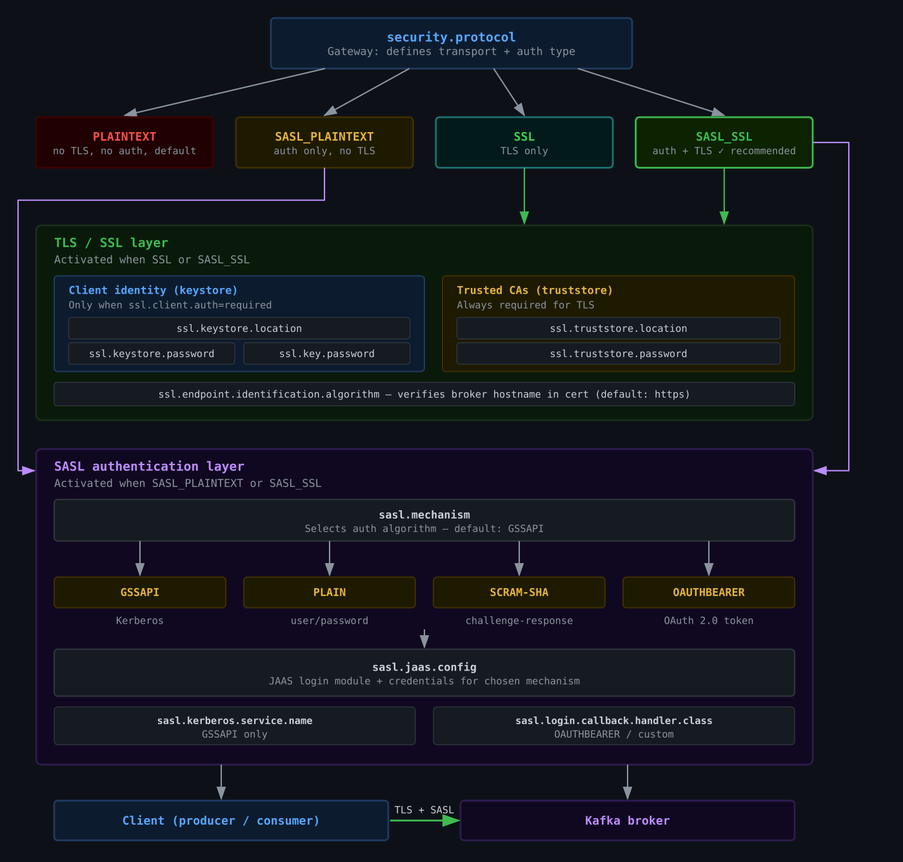

> 🚫 = outside the CCDAK exam scope (see exam blueprint)

## Kafka Security Configurations

Securing Kafka involves configuring **encryption**, **authentication**, and **authorization** mechanisms to protect data in transit and at rest. Properly configuring security settings is crucial for safeguarding sensitive information and ensuring compliance with security standards.

### Key Points for CCDAK on Security

- **Encryption**: SSL/TLS encryption prevents data eavesdropping between clients and brokers.
- **Authentication**: SASL (PLAIN, SCRAM, GSSAPI/Kerberos, OAUTHBEARER) and SSL/mutual TLS (`ssl.client.auth=required`, default `none`) can be used to authenticate clients and brokers.
- **Authorization**: ACLs (not authentication) control access to Kafka resources, ensuring only authorized users can produce or consume data.
- **Comprehensive Security**: A combination of encryption, authentication, and authorization provides robust security.

### Important Security Properties

#### `ssl.key.password`
- **Description**: Password for the private key in the key store file. This is optional and used for keys.
- **Security Impact**: Protects the private key integrity, ensuring that only authorized users can access it.

#### `ssl.keystore.location`
- **Description**: Location of the keystore file containing the server certificate and private key.
- **Security Impact**: Enables SSL encryption for data in transit. Proper management ensures identity integrity.

#### `ssl.keystore.password`
- **Description**: Password to access the keystore file.
- **Security Impact**: Secures the keystore content against unauthorized access.

```
┌─────────────────────────────────────────────────┐
│           KEYSTORE FILE (.jks / .p12)           │
│         ← ssl.keystore.password protect it →    │
│                                                 │
│   ┌──────────────────────────────────────────┐  │
│   │         CERTIFICATE (public)             │  │
│   │         broker.example.com               │  │
│   └──────────────────────────────────────────┘  │
│                                                 │
│   ┌──────────────────────────────────────────┐  │
│   │         PRIVATE KEY                      │  │
│   │    ← ssl.key.password protect it →       │  │
│   │         (can have separate password)     │  │
│   └──────────────────────────────────────────┘  │
└─────────────────────────────────────────────────┘
```

#### `ssl.truststore.location`
- **Description**: Location of the truststore file containing certificates of trusted CAs (clients use it to verify the broker. Brokers use it to verify client certificates with mTLS).
- **Security Impact**: Essential for establishing trust relationships and validating certificate chains during SSL/TLS handshakes.

#### `ssl.truststore.password`
- **Description**: Password to unlock the truststore file.
- **Security Impact**: Protects the integrity of trusted certificates, ensuring they are not tampered with.

#### `sasl.mechanism`
- **Description**: Authentication method — how the client proves its identity . Examples include PLAIN, GSSAPI (Kerberos), SCRAM, etc.
- **Security Impact**: Defines the authentication protocol, directly affecting security strength and compatibility.

#### `sasl.jaas.config`
- **Description**: JAAS configuration for SASL mechanisms specifying login modules and relevant options, set inline (an alternative to a separate JAAS file passed via `-Djava.security.auth.login.config`).
- **Security Impact**: Central to SASL authentication setup, ensuring secure and flexible authentication configurations.

#### `security.protocol`
- **Description**: Transport layer — how the connection is established . Options include PLAINTEXT (default), SSL, SASL_PLAINTEXT, and SASL_SSL.
- **Security Impact**: Determines the level of security for data in transit between clients and brokers.

| Mechanism | Description | Use case |
|---|---|---|
| `GSSAPI` | Kerberos | default when SASL enabled, Enterprise/on-prem with KDC |
| `PLAIN` | username + password plaintext | simple, credentials in `sasl.jaas.config`. Use only with TLS |
| `SCRAM-SHA-256` | challenge-response, salted | username/password without sending plaintext credential |
| `SCRAM-SHA-512` | same as above, stronger hash | recommended over SCRAM-SHA-256 |
| `OAUTHBEARER` | OAuth 2.0 JWT token | cloud-native, token-based auth |

#### `ssl.endpoint.identification.algorithm`
- **Description**: The algorithm to use for host name verification of server certificates. Defaults to `https` (hostname verification enabled) since Kafka 2.0. An empty string disables it.
- **Security Impact**: Protects against man-in-the-middle attacks by verifying the server's hostname matches its certificate.

#### `sasl.login.callback.handler.class`
- **Description**: Specifies the callback handler class for SASL login if not using the default.
- **Security Impact**: Allows custom handling of authentication challenges and responses, enhancing flexibility in security configurations.

#### `sasl.kerberos.service.name`
- **Description**: The Kerberos principal name (service name, typically `kafka`) that Kafka runs as.
- **Security Impact**: Critical for integrating Kafka with Kerberos for strong authentication, ensuring that services communicate securely under mutual authentication.

### Core Principles for Robust Kafka Security

#### Encryption
- Implements SSL/TLS to safeguard data as it moves between Kafka clients and brokers, thwarting eavesdropping attempts.

#### Authentication
- Utilizes SASL and SSL for verifying client and broker identities, ensuring that only legitimate participants engage in communication.

#### Authorization

Apache Kafka ships with a pluggable, out-of-the-box Authorizer. In KRaft mode (the only mode since Kafka 4.0, when ZooKeeper and `AclAuthorizer` were removed) this is `StandardAuthorizer`, which stores ACLs in the cluster metadata log (`__cluster_metadata`). Setting ACLs is crucial because, without them, access to resources is limited to super users when an Authorizer is configured. By default (`allow.everyone.if.no.acl.found=false`), if a resource has no associated ACLs, no one except super users is allowed to access it.

ACLs authorize authenticated principals. They do not authenticate. Operations include Read (consume), Write (produce), Create, Delete, Alter, Describe, DescribeConfigs, AlterConfigs, IdempotentWrite. Resources: Topic, Group, Cluster, TransactionalId, DelegationToken, User (there is no Partition resource). Without a matching allow ACL the client gets an authorization exception (e.g. `TopicAuthorizationException`).

Access Control Lists (ACLs) provide essential authorization controls for your enterprise's Kafka cluster data.

To set the required ACLs to allow a specific user "Andoni" to read and write to the topic "test-topic" from host "test-host," use the following command:

```sh
bin/kafka-acls.sh --bootstrap-server localhost:9092 
                  --command-config admin.properties  --add 
                  --allow-principal User:Andoni 
                  --allow-host test-host 
                  --operation read 
                  --operation write --topic test-topic
```

#### Comprehensive Security Model
- A layered approach combining encryption, authentication, and authorization fortifies Kafka's security posture.

### Critical Security Configuration Parameters

#### SSL Configuration

- **`ssl.key.password`**: Secures the private key, preventing unauthorized access to critical encryption assets.
- **`ssl.keystore.location`**: Specifies the keystore's path, a fundamental component for SSL encryption, containing server certificates and keys.
- **`ssl.keystore.password`**: Protects the keystore's integrity, ensuring its contents remain confidential.
- **`ssl.truststore.location`**: Designates the truststore's path, essential for establishing trust chains during SSL handshakes.
- **`ssl.truststore.password`**: Guards the truststore against unauthorized alterations, maintaining the trust integrity.

#### SASL Configuration for Authentication

- **`sasl.mechanism`**: Defines the SASL mechanism (e.g., PLAIN, GSSAPI/Kerberos, SCRAM) for client-server authentication, influencing security level and protocol compatibility.
- **`sasl.jaas.config`**: Central to configuring SASL authentication, specifying login modules and options for various SASL mechanisms.
- **`sasl.login.callback.handler.class`**: Facilitates custom authentication challenge handling, offering flexibility in security setups.
- **`sasl.kerberos.service.name`**: Essential for Kerberos integration, ensuring secure mutual authentication between services.

#### Communication and Protocol Security

- **`security.protocol`**: Sets the communication protocol with brokers (e.g., PLAINTEXT, SSL, SASL_PLAINTEXT, SASL_SSL), directly affecting in-transit data security.
- **`ssl.endpoint.identification.algorithm`**: Enables hostname verification in server certificates to protect against man-in-the-middle attacks.

### Kafka JAAS Configuration Example

```
KafkaClient {
    com.sun.security.auth.module.Krb5LoginModule required
    useKeyTab=true
    storeKey=true
    keyTab="/tmp/reader.user.keytab"
    principal="reader@KAFKA.SECURE";
};
```

### Access Control with ACLs

Kafka provides ACLs for fine-grained access control, managed via:

```
authorizer.class.name=org.apache.kafka.metadata.authorizer.StandardAuthorizer
super.users=User:admin;User:kafka
allow.everyone.if.no.acl.found=false
security.inter.broker.protocol=SASL_SSL
```

#### Managing ACLs

- **Listing ACLs**: `kafka-acls.sh --bootstrap-server broker:9092 --list`
- **Adding ACLs**: `kafka-acls.sh --bootstrap-server broker:9092 --add --allow-principal User:Bob --allow-principal User:Alice --allow-host Host1 --allow-host Host2 --operation Read --operation Write --topic Test-topic`

### Kafka Security Diagram



In legacy ZooKeeper clusters, ZooKeeper supported configurations like:

```
authProvider=org.apache.zookeeper.server.auth.SASLAuthenticationProvider
jaasLoginRenew=3600000
kerberos.removeHostFromPrincipal=true
kerberos.removeRealmFromPrincipal=true
```

### 🚫 Migrating to Secure ZooKeeper ACLs (legacy)

The `zookeeper-security-migration` tool secured ZooKeeper znodes in legacy clusters. It is not relevant for KRaft.
