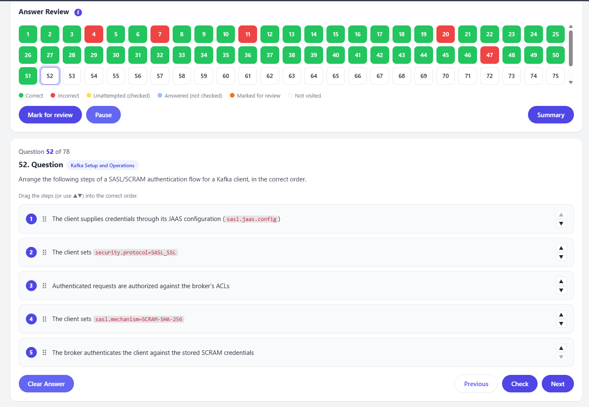

# Confluent Certified Developer for Apache Kafka (CCDAK) by Albi 



Study material for the **Confluent Certified Developer for Apache Kafka** exam: topic summaries, practice questions and full mock exams, also available as an interactive website.
Every question validated and checked by human :)

🌐 **Website:** [https://albi23.github.io/ccdak-certification](https://albi23.github.io/ccdak-certification/site/index.html)

## What's inside

| Content | Location | Size |
|---|---|---|
| Topic summaries (one per module) | `<N>.<module>/*-summary.md` | 12 modules |
| Per-module practice questions | `<N>.<module>/questions*.md` | ~245 questions |
| Mock exams (medium / harder / repeat) | `exams/` | **1127 questions** in 19 exams |
| Exam scope checklist | [`EXAM-SCOPE.md`](./EXAM-SCOPE.md) | |
| Last-minute review | [`LAST_MINUTE_REVIEW.md`](./LAST_MINUTE_REVIEW.md) | |
| KSQL / ZooKeeper extras | `ksql/`, `zookeeper/` | |

### Modules

1. Broker
2. Consumer
3. Producer
4. Topic
5. CLI & Testing
6. Kafka Streams
7. Kafka Connect
8. Security
9. Schema Registry
10. REST Proxy *(outside exam scope)*
11. Monitoring & Metrics
12. Cluster Administration *(outside exam scope)*

### Quality

Every question has a correct answer with a per-option explanation and was verified against sources: the official Apache Kafka documentation ([kafka.apache.org](https://kafka.apache.org/documentation/)), Confluent docs, and *Kafka: The Definitive Guide, 2nd Edition*. Summaries cite their sources inline.

## Build

The website and the quiz are generated from the markdown files.

```bash
pip install markdown-it-py
./build-all.sh
```

`build-all.sh` runs two steps in order:

1. `exams/build.py` renders all `exams/*/exam-questions-*.md` into one self-contained `exams/exam-test-aggregate.html`.
2. `site/build_site.py` renders the module summaries and `EXAM-SCOPE.md` into `site/index.html` and copies the quiz to `site/exam.html`.

Open `site/index.html` in a browser to preview locally. Everything works offline.

